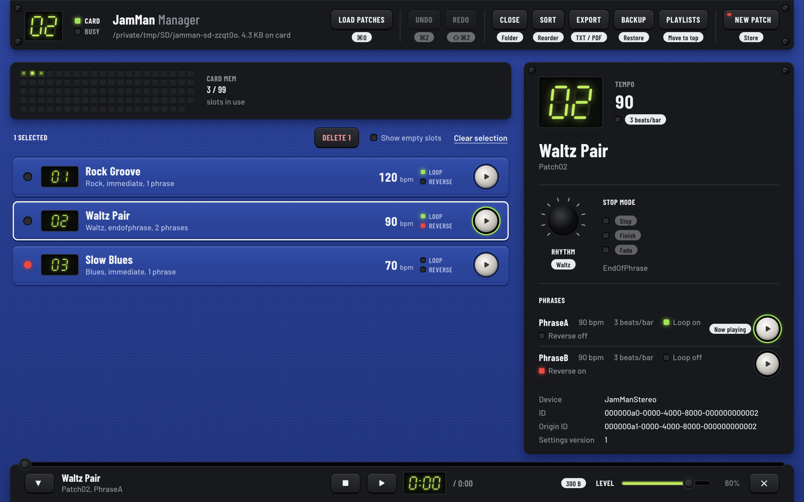

# JamMan Manager

A desktop app for managing the loops on a Digitech JamMan Stereo looper pedal. Put the pedal's SD card in your computer, open its folder, and you can play, create, edit, reorder, back up and delete patches without touching the pedal.

Built with Electron, React and TypeScript. Runs on macOS, Windows and Linux.



> There is no published release yet. To use the app, [build it from source](#build-installers).

## What it does

- **See the whole card.** A memory map of the 99 slots, the patch list with tempo, loop and reverse at a glance, and a detail panel for the selected patch.
- **Play phrases** from the card or from any patch row, with a player for seek and volume.
- **Create and edit patches.** Name, rhythm (the pedal's 10 rhythms, from Off to Tambourine), stop mode (Stop, Finish or Fade) and phrases. Each phrase has a WAV file, BPM, beats per bar, loop and reverse.
- **Delete** one patch or a selection.
- **Undo and redo** deletes, edits, reorders and restores with ⌘Z and ⇧⌘Z (Ctrl+Z and Ctrl+Shift+Z on Windows and Linux).
- **Reorder** patches by dragging them, or sort by name, slot, tempo or in reverse. Applying the order renumbers the folders from Patch01.
- **Playlists**: group patches into setlists, reorder them, export a setlist as text, and move a setlist to the first slots of the card.
- **Back up and restore** the whole card or only the selected patches as a ZIP file. Restore can merge with the patches on the card or replace them.
- **Export** the patch list as TXT or PDF.
- **Reopen** the last card you used when the app starts.

## Using it with the pedal

The JamMan Stereo stores each patch as a folder with an XML file and one folder per phrase:

```
JamManStereo/
├── Patch01/
│   ├── patch.xml
│   ├── PhraseA/
│   │   ├── phrase.xml
│   │   └── phrase.wav
│   └── PhraseB/
│       └── ...
├── Patch02/
└── ...
```

1. Put the SD card in your computer.
2. Click **Load patches** and pick the folder that contains `Patch01`, `Patch02`, and so on.
3. When you're done, eject the card before putting it back in the pedal.

The app only reads and writes inside the folder you pick, plus any WAV or backup file you choose in a file dialog.

### Over USB

You can also leave the card in the pedal and connect the pedal to the computer with a USB cable. The pedal does not show up as a drive; the app talks to it directly.

1. Turn the pedal on and connect it with a USB cable.
2. Click **Pedal** and choose **Internal memory** or **SD card**.
3. Browse and play the patches. Audio streams from the pedal, so playback starts right away; a WAV that was played to the end is kept in a local cache and not downloaded again until it changes on the pedal.
4. Create, edit, delete and sort patches, including adding phrases and replacing their WAV files. New WAVs are uploaded at about 1.5 MB per second, with a progress bar. Undo and redo work as with a card: audio that an undo may need is kept on the pedal itself, so it never crosses the cable twice.

5. Back up the bank to a ZIP file or restore one onto it. Audio that is not on this computer yet is downloaded first; the **Audio** key in the pedal dialog downloads a whole bank ahead of time. Both can be stopped and resumed. A large bank takes a long time over USB (about 50 minutes for 4 GB), so the app recommends a card reader for those.

Playlists are not available over USB yet: for those, put the card in a card reader. The protocol is documented in [docs/usb-protocol.md](docs/usb-protocol.md).

### WAV files

When you add a phrase, the app copies your WAV file to the card as it is. It does not convert it. Use 16-bit, 44.1 kHz WAV files (mono or stereo). Before playback the app checks that format and warns you if a file doesn't match.

## Development

### Requirements

- Node.js 24 or later. The version is in `.nvmrc`; with nvm, run `nvm use`.
- npm, which comes with Node.js. The repository uses npm workspaces.

### Run the app

```bash
npm install
npm start
```

`npm start` runs the renderer on the Vite dev server with hot reload and rebuilds the main and preload processes when they change.

### Build installers

```bash
npm run compile
```

This builds the app and packages it for the current platform into `dist/`:

| Platform | Output                               | Architectures |
| -------- | ------------------------------------ | ------------- |
| macOS    | DMG and ZIP                          | x64, arm64    |
| Windows  | NSIS installer and a portable `.exe` | x64           |
| Linux    | AppImage, `.deb` and `.rpm`          | x64           |

`npm run dist:mac`, `dist:win`, `dist:linux` and `dist:all` target a specific platform. [BUILD.md](BUILD.md) covers signing, notarization and releases.

### Checks

| Command                                   | What it does                                             |
| ----------------------------------------- | -------------------------------------------------------- |
| `npm run verify`                          | Typecheck, lint and unit tests                           |
| `npm test`                                | Unit tests (Vitest)                                      |
| `npm run test:e2e`                        | End-to-end tests (Playwright) against the app in `dist/` |
| `npm run format` / `npm run format:check` | Format the repository with Prettier, or only check it    |

The end-to-end tests launch the packaged app, so run `npm run compile` first. They use a small synthetic SD card in [`tests/fixtures`](tests/fixtures/README.md) and never touch a real card.

Husky runs `lint-staged` (Prettier) before each commit and `npm run verify` before each push. CI ([`.github/workflows/ci.yml`](.github/workflows/ci.yml)) builds the app and runs the unit tests on macOS, Windows and Linux. It also runs the typecheck, lint, a format check and a production dependency audit, and runs the end-to-end tests on Linux. All of it must pass before merging into `main`.

See [CONTRIBUTING.md](CONTRIBUTING.md) before opening a pull request, and [CHANGELOG.md](CHANGELOG.md) for release notes.

## Architecture

The app follows Electron's three-process model. The renderer has no Node.js access: everything it does on disk goes through a typed IPC contract.

```
┌──────────────────────┐
│  Renderer            │  React 19, Zustand, CSS Modules
└──────────┬───────────┘
           │  window.electronAPI (contextBridge)
┌──────────▼───────────┐
│  Preload             │  Typed IPC contract
└──────────┬───────────┘
           │  ipcRenderer.invoke / ipcMain.handle
┌──────────▼───────────┐
│  Main                │  File system, dialogs, backups, audio
└──────────────────────┘
```

### Main process (`packages/main`)

- **`ipc/`**: one handler file per area (patches, audio, backup, playlists, export, undo, dialogs), registered in `ipc/register.ts`.
- **`OperationQueue`**: runs file operations one at a time, with high, normal and low priorities.
- **`LockManager`**: an in-memory lock per patch folder, so two operations never write the same patch at once.
- **Recovering from failures**: a deleted patch is kept aside for 5 seconds before it's removed, a reorder that fails part-way renames the folders back, and edits, deletes and restores take a snapshot that Undo can bring back.
- **`BackupManager`** and **`PlaylistManager`**: ZIP backups and the playlists stored in `.jamman-playlists.json` on the card.
- **`modules/`**: window management, single instance, auto-updates and other app-level behaviour.
- **`usb/`**: the pedal over USB. `greenglassCodec` and `GreenglassClient` speak the pedal's protocol over the serial port (`serialport`), and `PedalManager` connects, reads patches live and serves phrase audio with a cache of downloaded WAVs. Handlers that take a folder path accept `jamman-pedal://<bank>` for a pedal bank; the ones that cannot work on a pedal yet refuse it in `ipc/register.ts`.

### Preload (`packages/preload`)

[`ipc-contract.ts`](packages/preload/src/ipc-contract.ts) defines every channel, its arguments and its result. Both sides are typed from it, so the API listed there is the source of truth. The preload exposes it as `window.electronAPI`, grouped like this:

- **Dialogs**: pick the card folder, a WAV file or a backup file.
- **Patches**: read, create, update, delete (one or a batch), reorder, export as TXT or PDF.
- **Audio**: get a playable URL for a phrase, check a WAV file's format, read a WAV file.
- **Backups**: create, validate and restore.
- **Undo**: create, restore and discard snapshots.
- **Playlists**: load, create, update, delete, add and remove patches, reorder, export.

### Renderer (`packages/renderer`)

- **`components/`**: the screens (header, memory map, patch list and detail, player, dialogs, sort view).
- **`ui/`**: the reusable components of the "Pedal" design system: panels, keys, LEDs, the seven-segment display, form controls, dialogs. The tokens and rules are in [design/DESIGN.md](design/DESIGN.md).
- **`store/`**: Zustand stores for the patches, the audio player and the undo history.

### Security

- The renderer runs sandboxed, with context isolation and a strict Content Security Policy.
- The main process only accepts IPC calls from the app's own window.
- File access is limited to the folder you picked and to the files you chose in a dialog.
- Audio plays through a custom `jamman://` protocol instead of `file://` URLs. See [ADR 0001](docs/adr/0001-jamman-protocol.md).
- Patch and phrase XML is parsed with external entities and DTDs disabled.

## Project structure

```
jamman-manager/
├── packages/
│   ├── main/               # Electron main process
│   │   └── src/
│   │       ├── ipc/        # IPC handlers by area
│   │       ├── modules/    # Window, updates, single instance…
│   │       ├── security/   # CSP, folder access, jamman:// protocol
│   │       └── index.ts
│   ├── preload/            # contextBridge and the IPC contract
│   ├── renderer/           # React UI
│   │   └── src/
│   │       ├── components/ # Screens
│   │       ├── ui/         # Design system components
│   │       ├── store/      # Zustand stores
│   │       └── styles/     # Design tokens
│   ├── electron-versions/  # Shared Electron/Chrome/Node targets
│   └── dev-mode.js         # `npm start`
├── tests/                  # E2E tests (Playwright) and the synthetic SD card
├── design/                 # DESIGN.md, mockups and icon options
├── docs/                   # ADRs, specs and policies
├── buildResources/         # App icon and macOS entitlements
└── electron-builder.mjs    # Packaging config
```

## Tech stack

- **App:** Electron, React 19, TypeScript, Vite
- **UI:** CSS Modules with design tokens, Barlow and Barlow Condensed (bundled with @fontsource), dnd-kit for drag and drop, React Toastify
- **State:** Zustand
- **Files:** fs-extra, xml2js, adm-zip (backups), pdfkit (PDF export), music-metadata (WAV checks)
- **App services:** electron-log, electron-updater
- **Tooling:** Vitest, Playwright, ESLint, Prettier, Husky, lint-staged

Dependencies follow [docs/dependency-policy.md](docs/dependency-policy.md).

## Why?

Digitech discontinued official support for managing loops on the JamMan Stereo. This app helps you keep control of your loop library with a modern interface: no MIDI, no syncing, just drag, drop and play.

## License

MIT License. See [LICENSE](LICENSE).
© 2025 Renán Gabriel Díaz Reyes

---

Made with ❤️ by a bassist and dev 🤘
